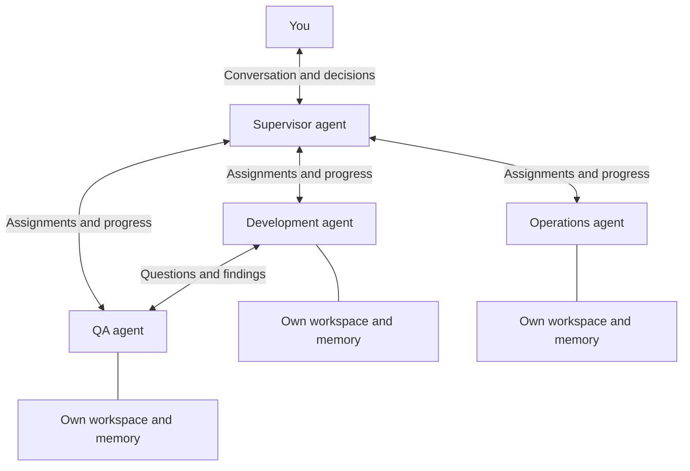
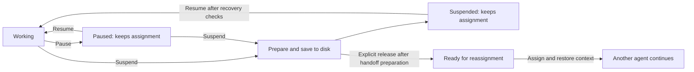

> **Under development**

# NimbleNewt

  

**Talk to your agents without making them lose their place.**

NimbleNewt gives you a persistent team of AI agents that you direct through conversation. You can ask questions, develop ideas, and change priorities while your agents keep their place in the work.

Pause and Suspend keep task working context separate from side conversations. A quick question leaves the task ready to continue; a change of task saves its working state for later. Keeping important working state separate from side conversations reduces unnecessary reconstruction and supports efficient, focused work.

The product targets **macOS, Linux, and Windows**, with configurable local and cloud models.

## Your team at a glance

You can talk to the supervisor or any agent directly. This is one example team; roles are configurable.

## How it works

- **You direct the team through conversation.** Talk to an agent or supervisor to plan a project, get help, or ask what’s happening. Your decisions take precedence over the agents’ recommendations.
- **Agents have roles and responsibilities.** Supervisors coordinate specialists in development, QA, operations, research, marketing, support, design, and documentation. They handle both individual tasks and ongoing responsibilities.
- **Each agent has its own workspace and memory.** Its “desk” holds its history, current work, and next steps. Agents can read authorized team records and ask each other questions, while keeping private scratch notes and their own environments.
- **Other tools and agents can connect.** A permission-checked API lets authorized clients add or edit durable state. Agents running in other harnesses can have ongoing, two-way conversations with NimbleNewt agents and return to the same thread later.
- **Work can be interrupted and resumed.** Agents switch between tasks and conversations while retaining the context needed to return. Pause retains assignments and allows background jobs to continue. Suspend prepares and saves work to disk so it can survive a reboot. Suspend and Release also prepares it for another agent to take over.
- **The team meets and plans.** Scheduled stand-ups let agents report progress, discuss problems, and propose improvements. You can join, call a meeting, or catch up through a summary and full transcript. Votes include short reasons; unattended decisions stay within your delegated authority.
- **Supervisors help agents get unstuck.** When an agent repeats failed steps or spends too long without useful progress, its supervisor can redirect it, interrupt a stuck model request, or try another model using saved task context. Recovery attempts have limits, and unresolved problems come back to you.
- **Models match the work.** Task difficulty selects a configurable model profile. Ordered backup models handle provider outages or planned maintenance, subject to your permissions and data-sharing settings.
- **Agents improve their tools.** They can develop skills and tools in their own environments. Authorized maintainers review useful additions for a shared toolbox. Budgets balance delivering work with improving how the team works.
- **You can review what happened.** Conversation history, tool activity, results, and recorded decisions make work inspectable. Agents check their own work, with independent QA where required.

## Talk without losing the task

Imagine an agent working on Task A when you ask, “How is it going?” It pauses the task at a safe point and answers using its task context, notes, current project files, and shared information it is allowed to read. The conversation has its own context, so incidental chat does not crowd out the task's working state.

If nothing needs to change, the agent returns to the retained Task A context and continues without starting the task over. Relevant decisions carry back into the work; the rest of the conversation stays in its own history.

If you say, “Task B is urgent. Do that first,” the agent suspends Task A: let running commands finish or end them safely, then save its progress, decisions, and next steps. After B, it restores A's saved context and checks relevant changes, such as updated files, teammate results, or new decisions, before continuing.

**Pause** sets foreground work aside while retaining the task; permitted background jobs may continue. **Suspend** prepares and saves the task for later. Both keep it assigned to the same agent. An authorized brief conversation can return to work automatically; a manual Pause or Suspend remains in place until you authorize resuming.

## Pause, come back, or hand off

Pausing keeps work assigned to the same agent. Suspension takes time to prepare and save resumable work; releasing it for another agent is an explicit choice.

Saved work survives restarts. Existing permitted background jobs may continue during Pause; Suspend settles or checkpoints them as part of preparation.

## Your projects, your rules

One human owner directs each installation. NimbleNewt works across multiple repositories and services without requiring special files in those repositories. Its internal records stay separate from the work you submit to your organization or an open-source project.

Scoped permissions, isolated agent environments, protected files, and approval rules control what agents can change. Each installation is configurable rather than tied to a particular provider or private infrastructure.

## Under the hood

A controller manages tasks, permissions, communication, model routing, and persistent records. Harness adapters run the agents, with **Pi Durable** selected as the initial runtime direction.

TypeScript is the default language for the controller, worker adapter, API, and UI, allowing direct integration with Pi Durable. A narrowly scoped Rust component is considered only when a demonstrated need justifies it.

## Design and implementation status

NimbleNewt is under development. The lifecycle and context behavior above is the product contract to implement. Pi Durable is the selected initial runtime direction. The Pi adapter milestone (G02) is implemented and passes CI on Linux, macOS and Windows; real-hardware QA (D04) and owner sign-off are still to come; its record lists the capabilities that are still unsupported ([G02 acceptance record](docs/nimblenewt/implementation-plan/g02-acceptance.md)). Beneath it, versioned configuration, the controller storage layer (SQLite and PostgreSQL 17 and above, with journaled migrations), the protected tool registry, project and task records, and verified artifacts are implemented, as are assignment, delivery, the security layer (principals, grants, review), desks and histories, retrieval, routing, host registration, admission and inquiries, and the state API (see the roadmap for the exact list); the worker runtime, sandboxing, tools, the UI and everything else are not built. See the roadmap below. Efficiency and quality improvements are goals to evaluate, not measured performance claims or a launch-date commitment.

Durable continuity uses recorded histories, tool results, notes, decisions, artifacts and checkpoints. These are distinct from arbitrary process-memory snapshots, hidden model state or a provider's live KV cache. Restore native history where supported and expose fidelity limits when reconstructing from portable records. Exact bit-for-bit continuation, zero latency and universal cache retention are not promised.

Suspend must settle or explicitly track in-flight operations before declaring readiness. A blocked or uncertain effect cannot be treated as successful cleanup. Return must recheck relevant changes, ownership, permissions and lifecycle gates. Authorized peers' published work records are read-only; private scratch requires an explicit grant. See the [operational contracts](docs/nimblenewt/operational-contracts.md) and [full design](docs/nimblenewt/README.md) for these engineering boundaries. The controller's versioned state API (the one door chat and API clients share) is documented in [api-v1](docs/nimblenewt/api-v1.md).

## Roadmap

NimbleNewt is built in 22 major parts. Open a part to see its cards, what each needs and how far each is. Within a part, cards are listed in dependency order, and each shows its phase ("P7" is the seventh step of the longest dependency chain): a card needs only cards from earlier phases, so cards in one phase can proceed in parallel. Card IDs match the [executable task plan](docs/nimblenewt/implementation-plan/task-plan.md). Progress: **203 of 309 tasks implemented**.

> Implementation began on the owner's instruction of 2026-10-19 to begin working on the project, on the Pi-first path; N00's formal scope and budget record is still an open owner item.

This section is generated from `task-plan.json`: edit the PROGRESS table in `scripts/generate_task_plan.py`, run it, then run `npm run roadmap:write`; `npm test` fails if it is stale.

Legend: `[x]` implemented, reviewed by a separate AI session, CI green (not a human review) · `[~]` implemented, awaiting sign-off the implementer cannot give · `[ ]` not started. Bars: ▓ implemented, ▒ awaiting sign-off, ░ not yet. Task prefixes: G gates and experiments, F foundation, S state, L lifecycle, C context, A security, R routing, U interface, H workers, M meetings, T tools, P projects, Q quality, B budgets and learning, K operations, V supervision, X test campaigns, Y QA checkpoints, D release.

### Progress by part

| Part | Progress | Done |
| --- | --- | --- |
| Scope and early proofs | `▓▓▓▓▓▓░░░░░░` 50% | 2 of 4 |
| Foundation: storage, configuration and builds | `▓▓▓▓▓▓▓▓▓▓▓░` 93% | 15 of 16 |
| Pi runtime and inference caching | `▓▓▓▓▓▓▓▓░░░░` 72% | 8 of 11 |
| Projects, tasks and reliable work | `▓▓▓▓▓▓▓▓▓▓▓▓` 100% | 11 of 11 |
| Pause, suspend and resume | `▓▓▓▓▓▓▓▓▓░░░` 78% | 18 of 23 |
| Security: identity, approvals and sandboxing | `▓▓▓▓▓▓▓▓▓░░░` 80% | 17 of 21 |
| Context and memory | `▓▓▓▓▓▓▓▓▓▓░░` 90% | 20 of 22 |
| State API and MCP state | `▓▓▓▓▓▓▓▓░░░░` 66% | 2 of 3 |
| Model routing, fallback and cost | `▓▓▓▓▓▓▓▓▓▓▓░` 92% | 12 of 13 |
| Owner chat and web UI | `▓▓▓▓▓▓▓░░░░░` 64% | 11 of 17 |
| Workers, dispatch and teams | `▓▓▓▓▓▓▓░░░░░` 65% | 31 of 47 |
| Agent messaging | `▓▓▓▓▓▓▓▓▓▓░░` 87% | 7 of 8 |
| Health and recovery | `▓▓▓▓▓▓▓▓▓▓░░` 83% | 5 of 6 |
| Meetings | `▓▓▓▓▓▓▓▓░░░░` 73% | 19 of 26 |
| Tools and skills | `▓▓▓▓▓▓▓▓▓░░░` 75% | 12 of 16 |
| Projects, repositories and workspaces | `▓▓▓▓░░░░░░░░` 35% | 6 of 17 |
| Quality: deliverables, QA and defects | `░░░░░░░░░░░░` 0% | 0 of 5 |
| Balancing delivery and improvement | `░░░░░░░░░░░░` 0% | 0 of 1 |
| Learning and improvement | `░░░░░░░░░░░░` 0% | 0 of 5 |
| Backup, updates and operations | `▓▓▓░░░░░░░░░` 26% | 4 of 15 |
| Test campaigns and platforms | `▓▓░░░░░░░░░░` 18% | 3 of 16 |
| Release | `░░░░░░░░░░░░` 0% | 0 of 6 |

### The parts in detail

<strong>Scope and early proofs</strong> — ▓▓▓▓▓▓░░░░░░ 2 of 4

The accepted scope and the experiments that proved the foundations (durable engine, remote stop and failover).

- [x] **G01** · P1 · Record accepted scope and experiment prerequisites — recorded; open owner decisions (N00 budget, PostgreSQL versions, minimum OS versions) listed in the record
- [x] **G07** · P2 · Record current architecture and executable task manifest _(needs G01)_
- [ ] **G04** · P31 · Prove supporting durable engine integration _(needs S09, F04d, F04f, F04g, G09)_
- [ ] **G08** · P41 · Prove remote stop and failover authority contracts _(needs H09, K05)_

<strong>Foundation: storage, configuration and builds</strong> — ▓▓▓▓▓▓▓▓▓▓▓░ 15 of 16

The controller's transactional storage (SQLite and PostgreSQL), versioned configuration, package boundaries, portable CI and the platform checks.

- [x] **F01** · P3 · Create TypeScript package boundaries _(needs G07)_
- [x] **F03** · P4 · Establish portable CI and test fixtures _(needs F01)_
- [x] **F02** · P8 · Implement versioned configuration and secret references _(needs F01, G02, G03)_
- [x] **F04a** · P8 · Define transactional controller storage contract _(needs F01, G02, G03)_
- [x] **F04b** · P9 · Implement SQLite controller storage adapter _(needs F04a)_
- [x] **F04c** · P9 · Implement PostgreSQL controller storage adapter _(needs F04a)_
- [x] **F04d** · P10 · Qualify storage adapter parity and contention _(needs F04b, F04c)_
- [x] **F04** · P11 · Define storage schema migration runners _(needs F04d)_
- [x] **F04f** · P12 · Move the SQLite adapter off the main thread _(needs F04)_
- [x] **F04g** · P12 · Verify supported PostgreSQL versions _(needs F04)_
- [x] **F04h** · P13 · Refuse unsupported environments unless explicitly overridden _(needs F04g)_
- [x] **F04i** · P14 · Refuse unsupported filesystems unless explicitly overridden _(needs F04h)_
- [x] **F09** · P21 · Implement per-OS secret store backends _(needs F02, A01)_
- [x] **F04j** · P22 · Check required tools and libraries instead of distribution names _(needs F04i, A03)_
- [x] **F04k** · P24 · Pass workspace roots to the startup filesystem check _(needs F04i, U01)_
- [ ] **F04e** · P33 · Implement chat-controlled controller database transfer _(needs F04, K01, F06)_

<strong>Pi runtime and inference caching</strong> — ▓▓▓▓▓▓▓▓░░░░ 8 of 11

The pinned Pi adapter, how it is upgraded, and the per-backend cache tuning that makes switching context cheap.

- [x] **F05** · P4 · Implement pinned Pi adapter submission contract _(needs F01)_
- [x] **F06** · P5 · Implement adapter checkpoints and cancellation mapping _(needs F05)_
- [x] **G02** · P6 · Accept the Pi adapter first milestone _(needs F05, F06, F03)_ — implemented and passing CI; owner signed off 2026-10-22; real macOS/Windows QA is carried out under D04
- [x] **G03** · P7 · Qualify forward migration and compatibility rejection _(needs G02)_
- [x] **F07** · P9 · Enforce immutable extension and namespace registration _(needs F05, F02)_
- [x] **F08** · P14 · Declare harness capabilities and enforce per-task recovery requirements _(needs F06, S02)_
- [x] **C06** · P26 · Implement inference-cache adapters with per-backend tuning _(needs C05)_
- [x] **C06b** · P27 · Make Pi agent prompts cache-stable across context switches _(needs C06, F05, F06)_
- [ ] **G10** · P27 · Benchmark native backend caching and branch markers _(needs C06)_
- [ ] **G09** · P30 · Prove retained-context inquiry and mid-generation interruption _(needs C05, L05, L05b)_
- [ ] **G11** · P36 · Qualify the Pi Durable runtime upgrade path _(needs G03, F07, K07)_

<strong>Projects, tasks and reliable work</strong> — ▓▓▓▓▓▓▓▓▓▓▓▓ 11 of 11

Project and task records, assignments, durable delivery, the effect ledger and artifacts: work that survives crashes without repeating itself.

- [x] **S01** · P12 · Implement project/task records and revisioned commands _(needs F04)_
- [x] **S06** · P12 · Implement artifact publication and integrity _(needs F04)_
- [x] **S02** · P13 · Implement assignment generations and attempt admission _(needs S01, F05)_
- [x] **S03** · P13 · Implement durable transition delivery _(needs S01)_
- [x] **S04** · P14 · Implement durable inbox and duplicate handling _(needs S03, S02)_
- [x] **S05** · P15 · Implement effect ledger and idempotent bridge _(needs S02, S04)_
- [x] **S07** · P16 · Implement startup and periodic reconciliation _(needs S03, S04, S05)_
- [x] **S08** · P17 · Implement typed waits and deadline settlement _(needs S04, S07)_
- [x] **S09** · P18 · Verify the durable vertical slice _(needs S05, S06, S07, S08, F06, G02, G03)_
- [x] **S10** · P22 · Implement task contracts and the task dependency graph _(needs S01, S08, A02)_
- [x] **C03** · P23 · Capture read/write/search dependency manifests _(needs S06, A04, C01)_

<strong>Pause, suspend and resume</strong> — ▓▓▓▓▓▓▓▓▓░░░ 18 of 23

Pause, suspend, stop, release and checked resume, interrupting a model mid-generation, the remote watchdog, and shutdown and reboot handling.

- [x] **L05** · P26 · Implement generation interruption and late-result handling _(needs C05, F06, A02)_
- [x] **L01** · P27 · Implement Pause and background settlement _(needs C04, A02, S08, L05)_
- [x] **L01b** · P29 · Run the reconciler and stall detection in the controller with the pause gates _(needs L01, H12)_
- [ ] **L05b** · P29 · Feed the model stream into revision-bound generation _(needs L05, H12)_
- [x] **L02** · P31 · Implement Suspend and graceful Stop _(needs L01, T07)_
- [x] **H08** · P32 · Implement remote disconnect watchdog and hard stop _(needs H02, L02)_
- [x] **L03** · P32 · Implement prepared release and reassignment _(needs L02, S02, S05)_
- [x] **L04** · P32 · Implement checked resume and evidence invalidation _(needs C03, L02, A02)_
- [ ] **H08b** · P33 · Run the lease watchdog in the real worker process _(needs H08, H12b)_
- [x] **L02b** · P33 · Resume stops after a restart and cover every scope _(needs L02, L03)_
- [x] **L03b** · P33 · Compose prepared hand-off into the running controller (operations) _(needs L03)_
- [x] **L04b** · P33 · Compose checked resume into the running controller (operations) _(needs L04)_
- [x] **L06** · P33 · Implement team and system shutdown, reboot and resume policy _(needs L02, L03, H08, U06, H11)_
- [x] **L02c** · P34 · Finish Stop: jobs, processes and child work in the inventory, cleanup spend _(needs L02b)_
- [x] **L03c** · P34 · Finish hand-off: chat, richer package, temporary reassignment, responsibilities _(needs L03b, L02b)_
- [ ] **L04c** · P34 · Call the checked resume from the dispatcher and observe dependencies _(needs L04b, H12k)_
- [x] **L06b** · P34 · Finish shutdown and resume: resume on a recorded authorized condition _(needs L06)_
- [ ] **L02d** · P35 · Finish Stop: local processes, child work, cleanup spend _(needs L02c)_
- [x] **L03d** · P35 · Finish hand-off: chat, richer package, temporary reassignment, responsibilities _(needs L03c)_
- [x] **L03e** · P36 · Finish hand-off: chat, richer package, temporary reassignment _(needs L03d)_
- [x] **L03f** · P37 · Finish hand-off: chat, richer package, locks, drafts _(needs L03e)_
- [x] **L03g** · P38 · Finish hand-off: locks, drafts, responsibilities in the package _(needs L03f)_
- [ ] **L03h** · P39 · Finish hand-off: a locks source, offering to reassign responsibilities _(needs L03g)_

<strong>Security: identity, approvals and sandboxing</strong> — ▓▓▓▓▓▓▓▓▓░░░ 17 of 21

Authenticated principals, revisioned grants, the sandbox launchers, the protected filesystem and Git bridge, approval policy and resource limits.

- [x] **A01** · P20 · Implement authenticated principals and capabilities _(needs S01, F02, S09, Y01)_
- [x] **A02** · P21 · Implement revisioned grants and restrictions _(needs A01)_
- [x] **A03** · P21 · Implement selected sandbox launcher _(needs A01, F03)_
- [ ] **A03b** · P22 · Implement the Windows Sandbox launcher _(needs A03)_
- [x] **A04** · P22 · Implement protected filesystem and Git bridge _(needs A03, S05)_
- [x] **A05** · P22 · Implement exact-operation review admission _(needs A02, S05, F07)_
- [x] **A06** · P23 · Implement human pre-commit gate and attribution _(needs A04, A05)_
- [x] **A07** · P23 · Implement action classes, default policy and effective-policy view _(needs A02, A05, F02)_
- [ ] **G05** · P23 · Prove selected isolation boundary per OS _(needs A03, A04)_
- [x] **A07b** · P25 · Implement standing-rule proposals and approval-load measurement _(needs A07, A05, H05)_
- [x] **A08** · P25 · Implement per-agent environments _(needs A03, T01, H11)_
- [x] **A10** · P25 · Implement private-record inspection and cross-project information boundaries _(needs C02, A02, H11)_
- [x] **A07c** · P26 · Implement the strict-to-derived profile suggestion _(needs A07, A07b)_
- [x] **A08b** · P26 · Enforce per-agent resource limits in the sandbox _(needs A08, A03)_
- [x] **A10b** · P26 · Implement per-task credentials for agents serving several projects _(needs A10, A01)_
- [x] **A07d** · P27 · Offer a choice of standing-grant lengths with a system-chosen default _(needs A07b, A07c)_
- [ ] **A08c** · P27 · Enforce per-agent resource limits on macOS and Windows (after the first release) _(needs A08b, A03b)_
- [x] **A07e** · P28 · Suggest at least seven days for a standing grant _(needs A07d)_
- [x] **A07f** · P30 · Derive protected branches in the controller and scope approval grants to branches _(needs A07, P01)_
- [x] **A07g** · P31 · Let only an integrator's contract cover protected branches _(needs A07f)_
- [ ] **A09** · P32 · Implement reviewed environment changes and maintenance requests _(needs A08, A05, H05, L02, T06)_

<strong>Context and memory</strong> — ▓▓▓▓▓▓▓▓▓▓░░ 20 of 22

Separated task, chat and meeting context, working notes, source-backed retrieval, safe-boundary continuation, retained branches, context budgets, owner decisions and the activity record.

- [x] **C01** · P21 · Implement separated task/chat/meeting histories _(needs S01, S06, A01, F06)_
- [x] **C02** · P22 · Implement bounded source-backed retrieval _(needs C01)_
- [x] **C04** · P24 · Implement safe-boundary continuation capture _(needs C02, C03, F06)_
- [x] **C05** · P25 · Implement retained context branches and selective updates _(needs C04, H04)_
- [x] **C07** · P25 · Implement context budgets, the startup builder and stall-proof helpers _(needs C04, R01)_
- [x] **C01b** · P26 · Implement the shared working-notes tier _(needs C01, A02, A10)_
- [x] **C07b** · P26 · Wire context budgets into dispatch and bound compaction _(needs C07, C04, R01)_
- [x] **C07d** · P27 · Scale MCP result limits to the window and let the rest be read in pages _(needs C07b, R02)_
- [x] **C07e** · P29 · Rebuild the context view when a model route changes to a smaller window _(needs C07d, H12)_
- [x] **C08** · P29 · Implement owner decision records and correction propagation _(needs C03, C07, U03, H06)_
- [ ] **C07f** · P30 · Measure the route's fixed part and scale remote MCP limits _(needs C07e, H12)_
- [x] **C08b** · P30 · Record decisions from the chat and interrupt running generation on correction _(needs C08, U03, L05)_
- [x] **C09** · P30 · Capture activity records and decision explanations _(needs C04, C08, T06, S05)_
- [x] **C08c** · P31 · Propose chat gates and strict decisions before applying them _(needs C08b)_
- [x] **C08d** · P31 · Turn a replayed chat turn after a topic change into a dispute _(needs C08b)_
- [x] **C09b** · P31 · Compose activity records into the running controller (operations) _(needs C09)_
- [x] **C09c** · P32 · Record activity at every step and explain through chat _(needs C09b)_
- [x] **C09d** · P33 · Record activity at every step: dispatcher, tools, messages, meetings, chat _(needs C09c)_
- [x] **C09e** · P34 · Record activity: approvals, messages, meetings, chat _(needs C09d)_
- [x] **C09f** · P35 · Record activity: approvals, messages, artifact versions, chat _(needs C09e)_
- [x] **C09g** · P36 · Record activity: artifact versions, chat, explanation index _(needs C09f)_
- [ ] **C09h** · P37 · Record activity: local worker artifacts, chat access, explanation index _(needs C09g, H12k)_

<strong>State API and MCP state</strong> — ▓▓▓▓▓▓▓▓░░░░ 2 of 3

The versioned state API that every client uses, and the controller-backed MCP state.

- [x] **U01** · P23 · Implement versioned state query/write API _(needs S01, A01, C02)_
- [x] **T04** · P24 · Implement controller-backed MCP state adapter _(needs U01, T03)_
- [ ] **U13** · P37 · Expose lifecycle, decisions, deliverables and activity through the state API _(needs U01, L02, Q01, C08, C09)_

<strong>Model routing, fallback and cost</strong> — ▓▓▓▓▓▓▓▓▓▓▓░ 12 of 13

Routes and capability policy, provider failure fallback, difficulty profiles, drain and cutover, and cost attribution.

- [x] **R01** · P22 · Implement model routing and capability policy _(needs F05, A02, F02)_
- [x] **R02** · P25 · Implement fallback and cumulative budget accounting _(needs R01, S05, C04)_
- [x] **R03** · P26 · Implement difficulty profiles and escalation _(needs R02, S10, H11)_
- [x] **R05** · P26 · Implement cost and resource attribution and delegated budgets _(needs R02, H03, S10)_
- [x] **R04** · P27 · Implement provider drain, cutover and failback policy _(needs R02, L05)_
- [x] **R04b** · P27 · Compose provider drain and cutover into the running controller (owner operations) _(needs R02, L05)_
- [x] **R05c** · P27 · Budget requests reach their addressee and budgets are exposed in the API _(needs R05, U11)_
- [x] **R05e** · P28 · Tell the delegated holder of a budget request _(needs R05c)_
- [x] **R05b** · P29 · Reserve before dispatch and settle after in the dispatcher _(needs R05, H12)_
- [x] **R05d** · P30 · Charge meeting presence to the budget ledger _(needs R05, M01)_
- [x] **R05f** · P31 · Charge supervision, review and background jobs and prove the charges through the state API _(needs R05d)_
- [x] **R05g** · P32 · Retry lost charges and prove a held meeting through budget.usage _(needs R05f)_
- [ ] **R04c** · P33 · Bind model calls, probes and cancellation to drain and cutover _(needs R04, R04b, H12k)_

<strong>Owner chat and web UI</strong> — ▓▓▓▓▓▓▓░░░░░ 11 of 17

Talking to your agents: the chat interpreter, policy editing, status and blocker explanations, recovery chat, notifications and the responsive web interface.

- [x] **U10** · P25 · Implement layered configuration, effective values and change history _(needs F02, R01, U01, H11)_
- [x] **U03b** · P26 · Back the owner chat interpreter and the coordinator with a routed model _(needs U01, U02, R01, R02)_
- [x] **U11** · P26 · Implement owner notifications _(needs U02, S08, U10)_
- [x] **U03d** · P27 · Let the owner reach the coordinator through the chat _(needs U01, U02, U03b)_
- [x] **U03** · P28 · Implement owner chat command interpretation _(needs U01, U02, R02, U03b, U03d)_
- [ ] **U03c** · P29 · Run the coordinator as a hosted agent with its own lifecycle (optional, after the first release) _(needs U03, H11, L01)_
- [x] **U04** · P29 · Implement conversational policy editing _(needs U03, A02, A05, A07, U10)_
- [x] **U05** · P29 · Implement chat status and blocker explanations _(needs U03, S08, H01)_
- [x] **U03e** · P30 · Let the owner grant and revoke rights through the state API and the chat _(needs U03, L01b)_
- [x] **U05b** · P30 · Verify artifacts and inspect failed handlings in the composed status _(needs U05, H06c)_
- [ ] **U09** · P31 · Implement read-only activity timeline and replay views _(needs C09, U05, A10, C06b)_
- [x] **U06** · P32 · Implement deterministic recovery chat controls _(needs U01, L02, A02)_
- [x] **U06b** · P33 · Recovery chat controls for routes and providers, and shorthand _(needs U06, R04)_
- [ ] **U07** · P33 · Qualify responsive web chat over private networking _(needs U03, U06, A01, R05)_
- [ ] **U14** · P33 · First-run setup assistant: guided configuration through chat before the first agent exists _(needs U03, U03b, U10, H11, A07c, P08, F02, F09, R01, H12k)_
- [ ] **U08** · P34 · Implement settings and administration views _(needs U07, U10, A07, F09, H11, R03, T03, A07b, A07c)_
- [ ] **U11b** · P34 · Implement notification levels, the Needs you view and escalation to Urgent _(needs U11, A07b, H05, M03, H12, K01, H01, H09, A08)_

<strong>Workers, dispatch and teams</strong> — ▓▓▓▓▓▓▓░░░░░ 31 of 47

Enrolled hosts, remote workers, priority admission, the local worker runtime and dispatcher, agents, teams and roles, reviews and wait-cycle handling.

- [x] **H01** · P21 · Implement worker enrollment and observation _(needs A01, S02)_
- [x] **H03** · P22 · Implement priority admission and reserved control capacity _(needs S08, H01)_
- [x] **H04** · P23 · Implement durable inquiries and correlation _(needs S04, C01, H03)_
- [x] **H05** · P24 · Implement review routing and wait-cycle prevention _(needs H04, A05)_
- [x] **H06** · P24 · Implement event subscriptions and gap recovery _(needs S07, C03)_
- [x] **H11** · P24 · Implement agent, team and role records _(needs A02, C01, R01, U01)_
- [x] **H06b** · P25 · Expire idle event subscriptions _(needs H06)_
- [x] **H11b** · P25 · Standard role templates with display labels _(needs H11)_
- [x] **H13** · P26 · Implement event source adapters and watchers _(needs H06, H01, R02)_
- [x] **H13b** · P26 · Compose event watching: polling, dispatch, wake and resume check _(needs H06, H01, R02)_
- [x] **H06c** · P27 · Deliver idle-expiry notices in the running controller _(needs H06b, U11)_
- [x] **H13c** · P27 · Finish event watching: wakes, source polling, resume check _(needs H13b)_
- [x] **H05b** · P28 · Implement reviewer pause and hold behaviour _(needs H05, L01)_
- [x] **H12** · P28 · Implement the local worker runtime and attempt dispatcher _(needs A03, A05, R01, C07b, C06b, S05, C04, F08, H03)_
- [x] **H13d** · P28 · Finish event watching: source polling, resume check, chat _(needs H13c)_
- [x] **H02** · P29 · Implement subordinate remote work/artifact transport _(needs H01, S06, A03, H12)_
- [ ] **H12b** · P29 · Bind the real sandbox launcher and worker process to the local runtime _(needs H12, A03, A08)_
- [x] **H12c** · P29 · Compose the dispatcher at controller start with a durable scan cursor _(needs H12)_
- [ ] **H12e** · P29 · Route Pi model calls through the cache adapter _(needs H12, C06b)_
- [x] **H12g** · P29 · Use the DNS-rebinding guard in the remote MCP client _(needs H12, T03)_
- [x] **H12h** · P29 · Route owner-mode reviews only to the owner _(needs H12, A05)_
- [x] **H12l** · P29 · Give the controller integration, checkout refresh and quarantine operations _(needs H12, A04, A06)_
- [x] **H13e** · P29 · Finish event watching: real sources, chat _(needs H13d)_
- [x] **H02b** · P30 · Fence a remote handle's controls by placement and close every failed startup _(needs H02)_
- [x] **H07** · P30 · Implement idle host polling and capability placement _(needs H02, H03)_
- [ ] **H12a** · P30 · Carry the dispatch contract to remote workers _(needs H12, H02)_
- [x] **H12d** · P30 · Quiesce attempts before integration, refresh and quarantine _(needs H12, A04, A06, H12l)_
- [ ] **H12i** · P30 · Give tasks controlled network routes through the worker relay _(needs H12b, A07, T01, T03, A03b)_
- [ ] **H12j** · P30 · Close the H12b worker-process gaps _(needs H12b)_
- [ ] **H12m** · P30 · Bind the workspace operations to the local host and to remote hosts _(needs H12l, A04, H12b, H02)_
- [x] **H02c** · P31 · Prove partition fencing, relocation integrity and the store owner in the composed controller _(needs H02b)_
- [x] **H02e** · P31 · Stop a poll from deleting a re-placed offer _(needs H02, H07)_
- [ ] **H07b** · P31 · Choose hosts by candidates, fall back on refusal and run the host poller in the worker process _(needs H07, H12a)_
- [x] **H07d** · P31 · Limit connections per address only before login _(needs H07)_
- [ ] **H12f** · P31 · Wire context enforcement, pause observation and message boundaries into the runtime _(needs H12, C07b, L01, U12)_
- [ ] **H12q** · P31 · Finish the quiesce: the landing path and the production workspace port _(needs H12d)_
- [x] **H02d** · P32 · Finish the composed-controller proofs of remote stop, checkpoint fencing and relocation refusals _(needs H02c)_
- [x] **H07c** · P32 · Decide local-only placement by profile and let chat override it _(needs H07, C08c)_
- [ ] **H12k** · P32 · Compose the local worker host in the controller _(needs H12b, H12c, H12d, H12f, H12g)_
- [x] **H07e** · P33 · Pass over remote hosts that would refuse the attempt _(needs H07, H07c)_
- [x] **H09** · P33 · Implement reconnect reconciliation and primary epochs _(needs H08, L04, S05)_
- [ ] **H13f** · P33 · Finish event watching: other real sources, choosing sources in settings, chat _(needs H13e, H12k)_
- [ ] **H09b** · P34 · Finish reconnect reconciliation: recovery handshake, explicit re-accept, adoption by a new primary _(needs H09)_
- [ ] **H10** · P34 · Implement distributed agent capacity and fan-in limits _(needs H07, H09, H03, R05)_
- [ ] **H12n** · P38 · End agent work with work.end _(needs H12, H12l, Q01b, P08)_
- [ ] **H12o** · P39 · Commit an approved submission exactly once _(needs H12n, A06)_
- [ ] **H12p** · P39 · Let the author refresh its own checkout before submitting _(needs H12n, H12m)_

<strong>Agent messaging</strong> — ▓▓▓▓▓▓▓▓▓▓░░ 7 of 8

Durable conversations between agents, delivery classes, and the MCP conversation adapter.

- [x] **U02** · P24 · Implement durable conversation service (threads, messages, cursors, delivery states) _(needs U01, H04)_
- [x] **U02b** · P25 · Implement the conversation transport and remote exposure _(needs U02)_
- [ ] **T05** · P26 · Implement MCP durable conversation adapter _(needs U02, U02b, T04)_
- [x] **U12** · P30 · Implement agent messages, delivery classes and interruption budget _(needs U02, S08, L05, M01)_
- [x] **U12b** · P30 · Deliver informational messages at check-ins and show agent questions in chat _(needs U02, S08, L05, M01)_
- [x] **U12c** · P32 · Finish agent messages: owner questions in chat, stand-up boundary _(needs U12b, M03b)_
- [x] **U12d** · P33 · Finish agent messages: stand-up boundary delivery, chat presentation _(needs U12c)_
- [x] **U12e** · P34 · Finish agent messages: chat presentation of owner questions _(needs U12d)_

<strong>Health and recovery</strong> — ▓▓▓▓▓▓▓▓▓▓░░ 5 of 6

Stall detection and bounded supervisor recovery.

- [x] **V01** · P25 · Implement health and progress stall detection _(needs H01, S08, C04, H11)_
- [x] **V01b** · P29 · Scale stall thresholds to the prompt size and the measured speed of the model _(needs V01, H12)_
- [x] **V01c** · P30 · Read the declared model speed from the routing table and the cache share from the cache adapter _(needs V01b)_
- [x] **V02** · P33 · Implement bounded supervisor recovery _(needs V01, V01b, L03, L04, R02, H05)_
- [x] **V02b** · P34 · Finish supervisor recovery: action ladder, escalation, loop recovery, carried context _(needs V02)_
- [ ] **V02c** · P35 · Finish supervisor recovery: the action ladder _(needs V02b)_

<strong>Meetings</strong> — ▓▓▓▓▓▓▓▓░░░░ 19 of 26

Scheduling, votes and decisions, stand-ups, attendance and return to work, and facilitation.

- [ ] **M00** · P2 · Prototype the meeting protocol and run meeting experiments _(needs G01)_
- [x] **M01** · P29 · Implement durable meeting scheduling and agendas _(needs H04, U03)_
- [x] **M01b** · P30 · Hold meetings with real participants through the composed API _(needs M01, U03)_
- [x] **M01c** · P30 · Wire the owner time zone and the invitation sink into the composed meetings _(needs M01)_
- [x] **M02** · P30 · Implement votes, decisions and meeting summaries _(needs M01, A02, C02, C08)_
- [x] **M02b** · P30 · Compose meeting records, votes and summaries into the running controller _(needs M01, A02, C02, C08)_
- [x] **M03** · P30 · Implement stand-up preparation, briefs and agenda items _(needs M01, C02, U03)_
- [x] **M04** · P30 · Implement meeting attendance and return to work _(needs M01, L01, L05, H04)_
- [x] **M01d** · P31 · Keep invited agents free for a configurable lead time before a meeting _(needs M01c)_
- [x] **M02c** · P31 · Finish meeting records: appliers, shareable checks, narrator, sweep loop, chat _(needs M02b)_
- [x] **M03b** · P31 · Compose stand-up notices, outcomes, allocation data and improvements _(needs M01, C02, U03, M02b)_
- [x] **M04b** · P31 · Compose meeting attendance: rooms, joining, wake and return _(needs M01, L01, L05, H04, M02b)_
- [ ] **M05** · P31 · Implement meeting facilitation and owner control _(needs M04, M02, U03, M00, A10, C01b)_
- [ ] **M06** · P31 · Implement meeting procedure, roster, quorum and ballots _(needs M02, A02, C08, T06, M00)_
- [x] **M02d** · P32 · Finish meeting records: other appliers, narrator, chat _(needs M02c)_
- [x] **M03c** · P32 · Finish stand-ups: sinks, improvements, real occurrences, chat _(needs M03b)_
- [x] **M04c** · P32 · Finish meeting attendance: sinks, dispatcher hints, chat _(needs M04b)_
- [ ] **M05b** · P32 · Prove meeting desk reads are read-only and recorded per file _(needs M05, C01b)_
- [x] **M02e** · P33 · Meeting records: grant, budget and ownership appliers, shareable-notes check _(needs M02d)_
- [x] **M03d** · P33 · Finish stand-ups: sinks, real occurrences, chat _(needs M03c)_
- [x] **M04d** · P33 · Finish meeting attendance: wake sinks, chat, stand-up link _(needs M04c)_
- [ ] **M02f** · P34 · Finish meeting records: decision log, steward agent, narrator, chat commands _(needs M02e)_
- [x] **M03e** · P34 · Finish stand-ups: other sinks, untold decisions shown to the owner, chat _(needs M03d)_
- [x] **M04e** · P34 · Finish meeting attendance: keep no long-running work during a meeting, stopped agents, chat _(needs M04d)_
- [ ] **M03f** · P35 · Finish stand-ups: agenda outcomes to chat turns and inquiries, other sinks, chat _(needs M03e)_
- [ ] **M04f** · P35 · Finish meeting attendance: chat wording for the stopped-agent exception, wake of agents the host reports stopped _(needs M04e)_

<strong>Tools and skills</strong> — ▓▓▓▓▓▓▓▓▓░░░ 12 of 16

The immutable tool and skill catalogue, review and promotion, MCP connections, the protected agent tool bridge and background jobs.

- [x] **T01** · P22 · Implement immutable tool/skill catalog and attribution _(needs F07, A03, C01)_
- [x] **T03** · P23 · Implement approved MCP client connections _(needs T01, A01, S05, F09)_
- [x] **T06** · P29 · Implement the protected agent tool bridge and execution service _(needs H12, T01)_
- [x] **U04b** · P29 · Let agents read the policy that binds them (operation) _(needs U03, A02, A05, A07, U10)_
- [ ] **T06b** · P30 · Wire the protected bridge into the composed worker across a process boundary _(needs T06, H12b, H12c)_
- [x] **T07** · P30 · Implement durable job records and job control _(needs T06, S05)_
- [x] **T09** · P30 · Implement command namespaces and alias dispatch _(needs T06, H11, U03)_
- [x] **U04c** · P30 · Put the policy in the agent context and let agents forward owner messages _(needs U03, A02, A05, A07, U10, U04b)_
- [ ] **T07b** · P31 · Give agents job control through the tool bridge and bind jobs to the sandbox, the MCP client and the API _(needs T07, T06b, H12g)_
- [x] **T09b** · P31 · Wire command namespaces into the controller, state API and chat and run built-in commands _(needs T09)_
- [x] **U04d** · P31 · Put the policy in the agent context _(needs U04c)_
- [x] **T09c** · P32 · Run queued toolbox commands through the approval gates _(needs T09b)_
- [x] **T09d** · P32 · Run queued agent commands _(needs T09b)_
- [x] **T02** · P33 · Implement review/promotion/deprecation and retention _(needs T01, A05, L04)_
- [ ] **T02b** · P34 · Finish catalog promotion: in-flight policy on revocation, retention _(needs T02)_
- [ ] **T08** · P35 · Implement shared toolbox audiences, personal copies and patch proposals _(needs T02, T06, M02, U08)_

<strong>Projects, repositories and workspaces</strong> — ▓▓▓▓░░░░░░░░ 6 of 17

Repository-independent projects, isolated coding workspaces, non-code and sandbox operations, ongoing responsibilities and external contribution.

- [x] **P01** · P29 · Implement repository-independent projects and responsibilities _(needs U03, S01)_
- [x] **P01b** · P30 · Mend the checkout pin edge cases _(needs P01)_
- [x] **P01c** · P31 · Scan the pin and overlap checks per project _(needs P01b)_
- [x] **P08** · P31 · Store the integration policy per project with an installation default _(needs P01, A07f, U10, H11b, A06)_
- [x] **P08b** · P32 · Change integration settings and create projects with them in chat _(needs P08, C08c, U03)_
- [ ] **P04** · P33 · Implement ongoing responsibility checks, incidents and coverage _(needs P01, S08, H13, V01, L03)_
- [x] **P08c** · P33 · Guide project creation in chat and list integration defaults _(needs P08b)_
- [ ] **P06** · P34 · Implement project and agent retirement and archival _(needs P01, H11, L03, K06)_
- [ ] **P02** · P35 · Implement isolated coding workspaces and integration _(needs P01, A04, L04, Y02, H12)_
- [ ] **P03** · P35 · Implement non-code and sandbox operations adapters _(needs P01, T01, S05, Y02, H12)_
- [ ] **P02b** · P36 · Implement optional work-in-progress branch backup (after the first release) _(needs P02, A06, A07, F09)_
- [ ] **P05** · P36 · Implement external contribution and pull-request workflow _(needs P02, A06, A07, T03, F09)_
- [ ] **P07** · P36 · Implement simulation mode _(needs P03, R02, T03)_
- [ ] **P09** · P38 · Gate landing on required checks for the exact integrated tree _(needs P08, Q01b, Q02)_
- [ ] **P10** · P40 · Land submissions with one leased integrator per project _(needs P08, P09, H12o, H12d, Q01b, A07f, Q04)_
- [ ] **P10b** · P41 · Share integrators across projects as a pool _(needs P10, H03, A10b, R05)_
- [ ] **P10c** · P41 · Promote to main automatically or by a human _(needs P10, A07f, P05)_

<strong>Quality: deliverables, QA and defects</strong> — ░░░░░░░░░░░░ 0 of 5

Deliverable submission and acceptance, independent QA, documentation impact and defect tracking.

- [ ] **Q01** · P36 · Implement deliverable submission and acceptance _(needs S06, U01, P02, P03, S10)_
- [ ] **Q01b** · P37 · Record submission kinds by role _(needs Q01, H11b)_
- [ ] **Q02** · P37 · Implement independent QA and dependency-bound evidence _(needs Q01, A06, C03, H05, C08)_
- [ ] **Q03** · P38 · Implement documentation impact and release evidence links _(needs Q02, C02)_
- [ ] **Q04** · P38 · Implement defect tracking, review cycles and overrides _(needs Q02, C08)_

<strong>Balancing delivery and improvement</strong> — ░░░░░░░░░░░░ 0 of 1

How capacity is split between production work and work that improves NimbleNewt.

- [ ] **B01** · P39 · Implement production/improvement budget admission _(needs H03, R02, Q01, Y03, R05)_

<strong>Learning and improvement</strong> — ░░░░░░░░░░░░ 0 of 5

Observations, versioned lessons, bounded experiments, scoped adoption and optional agent work on NimbleNewt itself.

- [ ] **B02** · P40 · Implement observations and provenance deduplication _(needs B01, H06, C01)_
- [ ] **B03** · P41 · Implement versioned lessons and triage _(needs B02, T01)_
- [ ] **B04** · P42 · Implement bounded baseline experiments _(needs B03, Q02, A08)_
- [ ] **B05** · P43 · Implement scoped adoption and monitored withdrawal _(needs B04, T02, L04)_
- [ ] **B06** · P44 · Implement optional agent work on NimbleNewt itself (off by default, asked ahead, owner-approved launch) _(needs B05, A10b, A08, K02, C09, H05)_

<strong>Backup, updates and operations</strong> — ▓▓▓░░░░░░░░░ 4 of 15

Backup and restore, release staging, migration recovery, maintenance windows and update orchestration.

- [x] **K01** · P32 · Implement consistent backup and restore _(needs S06, F04, L02, S05)_
- [ ] **K01b** · P33 · Implement encrypted backups with passcode and recovery-file unlock _(needs K01, F09)_
- [x] **K01e** · P33 · Finish backup: Pi state, maintenance barrier, owner restore, chat, off-tick nightly run _(needs K01)_
- [ ] **K06** · P33 · Implement retention, quotas, archive, export and deletion _(needs K01, S06, C02, C06b)_
- [ ] **K01c** · P34 · Implement the full configurable backup system (before 1.0) _(needs K01b, K06, U11)_
- [x] **K01f** · P34 · Finish backup: Pi state, maintenance barrier, owner restore, chat, non-blocking SQLite copy _(needs K01e)_
- [ ] **K02** · P34 · Implement deterministic release staging and activation _(needs K01, F02, T02)_
- [ ] **K06b** · P34 · Implement tiered retention (optional, after the first release) _(needs K06, C02)_
- [ ] **K01d** · P35 · Implement backup scope tiers (optional, after the first release) _(needs K01c, K06b)_
- [x] **K01g** · P35 · Finish backup: Pi state, maintenance barrier, in-controller restore _(needs K01f)_
- [ ] **K03** · P35 · Implement migration recovery and rollback limits _(needs K02, G03)_
- [ ] **K07** · P35 · Implement maintenance windows and update orchestration _(needs K02, K01, L06, U11, G05)_
- [ ] **K01h** · P36 · Finish backup: Pi state, maintenance barrier, in-controller restore _(needs K01g)_
- [ ] **K04** · P39 · Implement selected standby replication and recovery watermarks _(needs K01, K03, H09, Y03)_
- [ ] **K05** · P40 · Implement fenced primary promotion and recovery chat _(needs K04, U06)_

<strong>Test campaigns and platforms</strong> — ▓▓░░░░░░░░░░ 3 of 16

Crash, policy, isolation and partition campaigns, QA checkpoints, Windows and macOS qualification, and the typical and exhaustive test tiers.

- [x] **X11** · P2 · Split the test suite into a typical and an exhaustive tier _(needs G01)_
- [x] **Y01** · P19 · QA checkpoint 1: durable core _(needs S09, F04h)_
- [ ] **G06** · P24 · Qualify actual Windows implementation _(needs G02, G03, G05, F03)_
- [x] **X09** · P34 · Implement external release-test job protocol _(needs H07, H09, F03, S06)_
- [ ] **Y02** · P34 · QA checkpoint 2: isolation, stop and recovery _(needs G05, G06, A06, L04, H09, A03b, A08b, F04i, F04j, H06b)_
- [ ] **X09b** · P35 · Finish release testing: job delivery to the host, outer supervisor, chat wording _(needs X09)_
- [ ] **X01** · P38 · Run integrated crash and handoff campaign _(needs S09, V02, H02, Q02, K03, G04, H12, T07, K06, L06)_
- [ ] **Y03** · P38 · QA checkpoint 3: first complete chat-driven workflow _(needs U07, M02, P02, P03, Q02, K03, A07d)_
- [ ] **X10** · P42 · Run partition and remote-worker safety campaign _(needs X09, H10, K05, G08)_
- [ ] **X03** · P44 · Run chat-only complete product workflow _(needs U05, U06, U07, M02, P03, Q03, B05, K03, C06, L05, G09, C07, U09, U11, U12, U13, M03, M05, M06, R03, R04, P04, P06, P07, Q04, U08, H13, L06)_
- [ ] **X02** · P45 · Run policy, isolation and adversarial campaign _(needs A06, U04, H12n, H12p, P08, P10, P10b, A07f, T05, Q02, G05, A07, A09, A10, T08, T09, P05, H05b, A10b, M05b, B06, H12i)_
- [ ] **X04** · P46 · Qualify fresh macOS release candidate _(needs X01, X02, X03, X09, F03)_
- [ ] **X05** · P46 · Qualify fresh Linux release candidate _(needs X01, X02, X03, X09, F03)_
- [ ] **X06** · P46 · Qualify fresh Windows release candidate _(needs X01, X02, X03, X09, F03, G06)_
- [ ] **X07** · P47 · Measure load, inquiry latency and budget behavior _(needs X04, X05, X06)_
- [ ] **X08** · P48 · Run representative soak and independent release audit _(needs X07, X10, F04e, G10, K07, G11)_

<strong>Release</strong> — ░░░░░░░░░░░░ 0 of 6

Installation, documentation, QA on real machines, the release decision and closing the plan.

- [ ] **D02** · P36 · Finish developer/API/security and license guidance _(needs T05, K03, F03)_
- [ ] **D01** · P45 · Finish installation and chat-first user guidance _(needs X03, Q03, U11b)_
- [ ] **D03** · P49 · Approve release readiness and publication decision _(needs X08, D01, D02, F04h, T06b, U03b, U03e, C07d, L01b, V01b, F04k, T07b, H06c, R05b, R05c, R05d, H12a, H12b, H12c, H12d, H12e, H12f, H12g, H12h, H12i, H12j, H12k, H12l, H12m, X11, U05b, R05e, C08b, P01b, M01b, M01c, C08c, C08d, M01d, H02b, P01c, H02c, R05f, R05g, H02d, V01c, C07e, H07e, T09b, H07, H07b, H02e, T09, A07d, A07e, H07c, H07d, H11b, Q01b, A07f, P08, P08b, H12n, H12p, H12o, P09, P10, P10b, P10c, T09c, T09d)_
- [ ] **D04** · P50 · Run detailed real-world QA on macOS, Linux and Windows _(needs D03)_
- [ ] **D04b** · P51 · Measure code-navigation aids on real coding tasks (optional, after the first release) _(needs D04)_
- [ ] **D05** · P52 · Close the plan: every optional item built or deferred by the owner _(needs D04, D04b, U03c, K06b, K01d, P02b, A08c, C07f, L02b, H08b, U06b, P08c, A07g, R04b, R04c, L03b, L03c, L04b, L04c, C09b, C09c, U04b, U04c, M02b, M03b, M04b, H13b, U12b, M02c, M03c, M04c, H13c, U12c, L02c, U04d, L03d, C09d, M02d, M03d, M04d, H13d, L03e, C09e, K01e, U12d, K01f, C09f, L02d, C09g, K01g, H13e, M04e, M03e, M02e, M02f, K01h, M04f, M03f, L03f, U12e, H13f, C09h, L03g, H09b, V02b, L06b, T02b, X09b, L03h, V02c, H12q, U14)_

## More detail

- [Full design and document guide](docs/nimblenewt/README.md)
- [Agent state and conversation API design](docs/nimblenewt/agent-apis.md)
- [Accepted decisions and open questions](docs/nimblenewt/design-decisions.md)
- [Harness evaluation results](docs/nimblenewt/harness-test-results.md)
- [Reproducible harness experiments](benchmarks/nimblenewt-harness/README.md)
- [Proposed implementation backlog — not yet active](docs/paperclip-backlog.md)

## License

[MIT](LICENSE). Use, modify, and share NimbleNewt, including commercially. Contributions are welcome. Third-party dependencies retain their own licenses.

## Implementation plan

The [current design and executable task plan](docs/nimblenewt/implementation-plan/README.md) covers retained-context orchestration, SQLite/PostgreSQL, subordinate workers, approvals, backups and actual-code qualification. Historical probes are feasibility evidence. Documentation synchronization does not start implementation; N00 remains the activation gate.
