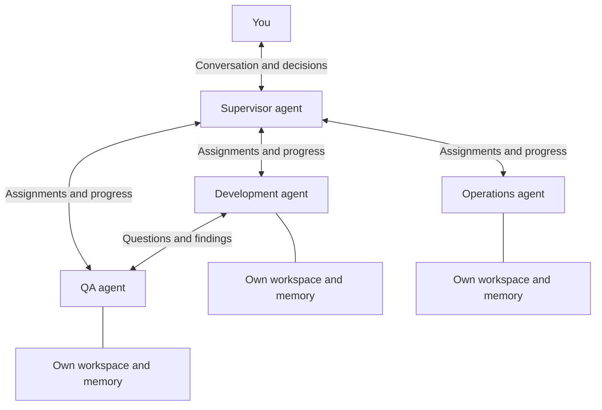
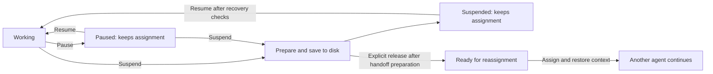

> **Under development**

# NimbleNewt

  

**Talk to your agents without making them lose their place.**

NimbleNewt gives you a persistent team of AI agents that you direct through conversation. You can ask questions, develop ideas, and change priorities while your agents keep their place in the work.

Pause and Suspend keep task working context separate from side conversations. A quick question leaves the task ready to continue; a change of task saves its working state for later. Keeping important working state separate from side conversations reduces unnecessary reconstruction and supports efficient, focused work.

The product targets **macOS, Linux, and Windows**, with configurable local and cloud models.

## Your team at a glance

You can talk to the supervisor or any agent directly. This is one example team; roles are configurable.

## How it works

- **You direct the team through conversation.** Talk to an agent or supervisor to plan a project, get help, or ask what’s happening. Your decisions take precedence over the agents’ recommendations.
- **Agents have roles and responsibilities.** Supervisors coordinate specialists in development, QA, operations, research, marketing, support, design, and documentation. They handle both individual tasks and ongoing responsibilities.
- **Each agent has its own workspace and memory.** Its “desk” holds its history, current work, and next steps. Agents can read authorized team records and ask each other questions, while keeping private scratch notes and their own environments.
- **Other tools and agents can connect.** A permission-checked API lets authorized clients add or edit durable state. Agents running in other harnesses can have ongoing, two-way conversations with NimbleNewt agents and return to the same thread later.
- **Work can be interrupted and resumed.** Agents switch between tasks and conversations while retaining the context needed to return. Pause retains assignments and allows background jobs to continue. Suspend prepares and saves work to disk so it can survive a reboot. Suspend and Release also prepares it for another agent to take over.
- **The team meets and plans.** Scheduled stand-ups let agents report progress, discuss problems, and propose improvements. You can join, call a meeting, or catch up through a summary and full transcript. Votes include short reasons; unattended decisions stay within your delegated authority.
- **Supervisors help agents get unstuck.** When an agent repeats failed steps or spends too long without useful progress, its supervisor can redirect it, interrupt a stuck model request, or try another model using saved task context. Recovery attempts have limits, and unresolved problems come back to you.
- **Models match the work.** Task difficulty selects a configurable model profile. Ordered backup models handle provider outages or planned maintenance, subject to your permissions and data-sharing settings.
- **Agents improve their tools.** They can develop skills and tools in their own environments. Authorized maintainers review useful additions for a shared toolbox. Budgets balance delivering work with improving how the team works.
- **You can review what happened.** Conversation history, tool activity, results, and recorded decisions make work inspectable. Agents check their own work, with independent QA where required.

## Talk without losing the task

Imagine an agent working on Task A when you ask, “How is it going?” It pauses the task at a safe point and answers using its task context, notes, current project files, and shared information it is allowed to read. The conversation has its own context, so incidental chat does not crowd out the task's working state.

If nothing needs to change, the agent returns to the retained Task A context and continues without starting the task over. Relevant decisions carry back into the work; the rest of the conversation stays in its own history.

If you say, “Task B is urgent. Do that first,” the agent suspends Task A: let running commands finish or end them safely, then save its progress, decisions, and next steps. After B, it restores A's saved context and checks relevant changes, such as updated files, teammate results, or new decisions, before continuing.

**Pause** sets foreground work aside while retaining the task; permitted background jobs may continue. **Suspend** prepares and saves the task for later. Both keep it assigned to the same agent. An authorized brief conversation can return to work automatically; a manual Pause or Suspend remains in place until you authorize resuming.

## Pause, come back, or hand off

Pausing keeps work assigned to the same agent. Suspension takes time to prepare and save resumable work; releasing it for another agent is an explicit choice.

Saved work survives restarts. Existing permitted background jobs may continue during Pause; Suspend settles or checkpoints them as part of preparation.

## Your projects, your rules

One human owner directs each installation. NimbleNewt works across multiple repositories and services without requiring special files in those repositories. Its internal records stay separate from the work you submit to your organization or an open-source project.

Scoped permissions, isolated agent environments, protected files, and approval rules control what agents can change. Each installation is configurable rather than tied to a particular provider or private infrastructure.

## Under the hood

A controller manages tasks, permissions, communication, model routing, and persistent records. Harness adapters run the agents, with **Pi Durable** selected as the initial runtime direction.

TypeScript is the default language for the controller, worker adapter, API, and UI, allowing direct integration with Pi Durable. A narrowly scoped Rust component is considered only when a demonstrated need justifies it.

## Design and implementation status

NimbleNewt is under development. The lifecycle and context behavior above is the product contract to implement. Pi Durable is the selected initial runtime direction. The Pi adapter milestone (G02) is implemented and passing CI on Linux, macOS and Windows, and awaits real-hardware QA and owner sign-off; its record lists the capabilities that are still unsupported ([G02 acceptance record](docs/nimblenewt/implementation-plan/g02-acceptance.md)). Beneath it, versioned configuration, the controller storage layer (SQLite and PostgreSQL 17 and above, with journaled migrations), the protected tool registry, project and task records, and verified artifacts are implemented; assignment, delivery, the API, workers, the UI and everything else are not built. See the roadmap below. Efficiency and quality improvements are goals to evaluate, not measured performance claims or a launch-date commitment.

Durable continuity uses recorded histories, tool results, notes, decisions, artifacts and checkpoints. These are distinct from arbitrary process-memory snapshots, hidden model state or a provider's live KV cache. Restore native history where supported and expose fidelity limits when reconstructing from portable records. Exact bit-for-bit continuation, zero latency and universal cache retention are not promised.

Suspend must settle or explicitly track in-flight operations before declaring readiness. A blocked or uncertain effect cannot be treated as successful cleanup. Return must recheck relevant changes, ownership, permissions and lifecycle gates. Authorized peers' published work records are read-only; private scratch requires an explicit grant. See the [operational contracts](docs/nimblenewt/operational-contracts.md) and [full design](docs/nimblenewt/README.md) for these engineering boundaries.

## Roadmap

Work is ordered by dependency: each phase needs only tasks from earlier phases, so everything within a phase can proceed in parallel. Task IDs match the [executable task plan](docs/nimblenewt/implementation-plan/task-plan.md). Progress: **25 of 113 tasks implemented**, 3 awaiting sign-off.

> Implementation began on the owner's instruction of 2026-10-19 to begin working on the project, on the Pi-first path; N00's formal scope and budget record is still an open owner item.

This section is generated from `task-plan.json`: edit the PROGRESS table in `scripts/generate_task_plan.py`, run it, then run `npm run roadmap:write`; `npm test` fails if it is stale.

Legend: `[x]` implemented, reviewed by a separate AI session, CI green (not a human review) · `[~]` implemented, awaiting sign-off the implementer cannot give · `[ ]` not started. Task prefixes: G gates, F foundations, S durable state, A authorization, C context, L lifecycle, H workers, R routing, U user interface, V supervision, M meetings, T tools, P projects, Q quality, B improvement, K backup/recovery, X release qualification, D documentation.

### Phase 1

- [~] **G01** Record accepted scope and experiment prerequisites — recorded; open owner decisions (N00 budget, PostgreSQL versions, minimum OS versions) listed in the record

### Phase 2

- [x] **G07** Record current architecture and executable task manifest _(needs G01)_

### Phase 3

- [x] **F01** Create TypeScript package boundaries _(needs G07)_

### Phase 4

- [x] **F03** Establish portable CI and test fixtures _(needs F01)_
- [x] **F05** Implement pinned Pi adapter submission contract _(needs F01)_

### Phase 5

- [x] **F06** Implement adapter checkpoints and cancellation mapping _(needs F05)_

### Phase 6

- [~] **G02** Accept the Pi adapter first milestone _(needs F05, F06, F03)_ — implemented and passing CI; awaiting independent macOS/Windows QA and owner sign-off

### Phase 7

- [x] **G03** Qualify forward migration and compatibility rejection _(needs G02)_

### Phase 8

- [x] **F02** Implement versioned configuration and secret references _(needs F01, G02, G03)_
- [x] **F04a** Define transactional controller storage contract _(needs F01, G02, G03)_

### Phase 9

- [x] **F04b** Implement SQLite controller storage adapter _(needs F04a)_
- [x] **F04c** Implement PostgreSQL controller storage adapter _(needs F04a)_
- [x] **F07** Enforce immutable extension and namespace registration _(needs F05, F02)_

### Phase 10

- [x] **F04d** Qualify storage adapter parity and contention _(needs F04b, F04c)_

### Phase 11

- [x] **F04** Define storage schema migration runners _(needs F04d)_

### Phase 12

- [x] **F04f** Move the SQLite adapter off the main thread _(needs F04)_
- [x] **F04g** Verify supported PostgreSQL versions _(needs F04)_
- [x] **S01** Implement project/task records and revisioned commands _(needs F04)_
- [x] **S06** Implement artifact publication and integrity _(needs F04)_

### Phase 13

- [x] **F04h** Refuse unsupported environments unless explicitly overridden _(needs F04g)_
- [x] **S02** Implement assignment generations and attempt admission _(needs S01, F05)_
- [x] **S03** Implement durable transition delivery _(needs S01)_

### Phase 14

- [x] **S04** Implement durable inbox and duplicate handling _(needs S03, S02)_

### Phase 15

- [x] **S05** Implement effect ledger and idempotent bridge _(needs S02, S04)_

### Phase 16

- [x] **S07** Implement startup and periodic reconciliation _(needs S03, S04, S05)_

### Phase 17

- [x] **S08** Implement typed waits and deadline settlement _(needs S04, S07)_

### Phase 18

- [x] **S09** Verify the durable vertical slice _(needs S05, S06, S07, S08, F06, G02, G03)_

### Phase 19

- [~] **Y01** QA checkpoint 1: durable core _(needs S09, F04h)_

### Phase 20

- [ ] **A01** Implement authenticated principals and capabilities _(needs S01, F02, S09, Y01)_

### Phase 21

- [ ] **A02** Implement revisioned grants and restrictions _(needs A01)_
- [ ] **A03** Implement selected sandbox launcher _(needs A01, F03)_
- [ ] **C01** Implement separated task/chat/meeting histories _(needs S01, S06, A01, F06)_
- [ ] **H01** Implement worker enrollment and observation _(needs A01, S02)_

### Phase 22

- [ ] **A04** Implement protected filesystem and Git bridge _(needs A03, S05)_
- [ ] **A05** Implement exact-operation review admission _(needs A02, S05, F07)_
- [ ] **C02** Implement bounded source-backed retrieval _(needs C01)_
- [ ] **H02** Implement subordinate remote work/artifact transport _(needs H01, S06, A03)_
- [ ] **H03** Implement priority admission and reserved control capacity _(needs S08, H01)_
- [ ] **R01** Implement model routing and capability policy _(needs F05, A02, F02)_
- [ ] **T01** Implement immutable tool/skill catalog and attribution _(needs F07, A03, C01)_

### Phase 23

- [ ] **A06** Implement human pre-commit gate and attribution _(needs A04, A05)_
- [ ] **C03** Capture read/write/search dependency manifests _(needs S06, A04, C01)_
- [ ] **G05** Prove selected isolation boundary per OS _(needs A03, A04)_
- [ ] **H04** Implement durable inquiries and correlation _(needs S04, C01, H03)_
- [ ] **H07** Implement idle host polling and capability placement _(needs H02, H03)_
- [ ] **T03** Implement approved MCP client connections _(needs T01, A01, S05)_
- [ ] **U01** Implement versioned state query/write API _(needs S01, A01, C02)_

### Phase 24

- [ ] **C04** Implement safe-boundary continuation capture _(needs C02, C03, F06)_
- [ ] **G06** Qualify actual Windows implementation _(needs G02, G03, G05, F03)_
- [ ] **H05** Implement review routing and wait-cycle prevention _(needs H04, A05)_
- [ ] **H06** Implement event subscriptions and gap recovery _(needs S07, C03)_
- [ ] **T04** Implement controller-backed MCP state adapter _(needs U01, T03)_
- [ ] **U02** Implement durable conversation API and transport _(needs U01, H04)_

### Phase 25

- [ ] **C05** Implement retained context branches and selective updates _(needs C04, H04)_
- [ ] **C07** Enforce context budgets and stall-proof compaction _(needs C04, R01)_
- [ ] **R02** Implement fallback and cumulative budget accounting _(needs R01, S05, C04)_
- [ ] **T05** Implement MCP durable conversation adapter _(needs U02, T04)_
- [ ] **V01** Implement health and progress stall detection _(needs H01, S08, C04)_

### Phase 26

- [ ] **C06** Implement optional inference-cache capability adapters _(needs C05)_
- [ ] **L05** Implement generation interruption and late-result handling _(needs C05, F06, A02)_
- [ ] **U03** Implement owner chat command interpretation _(needs U01, U02, R02)_

### Phase 27

- [ ] **G09** Prove retained-context inquiry and mid-generation interruption _(needs C05, L05)_
- [ ] **G10** Benchmark native backend caching and branch markers _(needs C06)_
- [ ] **L01** Implement Pause and background settlement _(needs C04, A02, S08, L05)_
- [ ] **M01** Implement durable meeting scheduling and agendas _(needs H04, U03)_
- [ ] **P01** Implement repository-independent projects and responsibilities _(needs U03, S01)_
- [ ] **U04** Implement conversational policy editing _(needs U03, A02, A05)_
- [ ] **U05** Implement chat status and blocker explanations _(needs U03, S08, H01)_

### Phase 28

- [ ] **G04** Prove supporting durable engine integration _(needs S09, F04d, F04f, F04g, G09)_
- [ ] **L02** Implement Suspend and graceful Stop _(needs L01)_
- [ ] **M02** Implement votes, decisions and meeting summaries _(needs M01, A02, C02)_

### Phase 29

- [ ] **H08** Implement remote disconnect watchdog and hard stop _(needs H02, L02)_
- [ ] **K01** Implement consistent backup and restore _(needs S06, F04, L02, S05)_
- [ ] **L03** Implement prepared release and reassignment _(needs L02, S02, S05)_
- [ ] **L04** Implement checked resume and evidence invalidation _(needs C03, L02, A02)_
- [ ] **U06** Implement deterministic recovery chat controls _(needs U01, L02, A02)_

### Phase 30

- [ ] **F04e** Implement chat-controlled controller database transfer _(needs F04, K01, F06)_
- [ ] **H09** Implement reconnect reconciliation and primary epochs _(needs H08, L04, S05)_
- [ ] **T02** Implement review/promotion/deprecation and retention _(needs T01, A05, L04)_
- [ ] **U07** Qualify responsive web chat over private networking _(needs U03, U06, A01)_
- [ ] **V02** Implement bounded supervisor recovery _(needs V01, L03, L04, R02, H05)_

### Phase 31

- [ ] **H10** Implement distributed agent capacity and fan-in limits _(needs H07, H09, H03)_
- [ ] **K02** Implement deterministic release staging and activation _(needs K01, F02, T02)_
- [ ] **X09** Implement external release-test job protocol _(needs H07, H09, F03, S06)_
- [ ] **Y02** QA checkpoint 2: isolation, stop and recovery _(needs G05, G06, A06, L04, H09)_

### Phase 32

- [ ] **K03** Implement migration recovery and rollback limits _(needs K02, G03)_
- [ ] **P02** Implement isolated coding workspaces and integration _(needs P01, A04, L04, Y02)_
- [ ] **P03** Implement non-code and sandbox operations adapters _(needs P01, T01, S05, Y02)_

### Phase 33

- [ ] **D02** Finish developer/API/security and license guidance _(needs T05, K03, F03)_
- [ ] **Q01** Implement deliverable submission and acceptance _(needs S06, U01, P02, P03)_

### Phase 34

- [ ] **Q02** Implement independent QA and dependency-bound evidence _(needs Q01, A06, C03, H05)_

### Phase 35

- [ ] **Q03** Implement documentation impact and release evidence links _(needs Q02, C02)_
- [ ] **X01** Run integrated crash and handoff campaign _(needs S09, V02, H02, Q02, K03, G04)_
- [ ] **X02** Run policy, isolation and adversarial campaign _(needs A06, U04, T05, Q02, G05)_
- [ ] **Y03** QA checkpoint 3: first complete chat-driven workflow _(needs U07, M02, P02, P03, Q02, K03)_

### Phase 36

- [ ] **B01** Implement production/improvement budget admission _(needs H03, R02, Q01, Y03)_
- [ ] **K04** Implement selected standby replication and recovery watermarks _(needs K01, K03, H09, Y03)_

### Phase 37

- [ ] **B02** Implement observations and provenance deduplication _(needs B01, H06, C01)_
- [ ] **K05** Implement fenced primary promotion and recovery chat _(needs K04, U06)_

### Phase 38

- [ ] **B03** Implement versioned lessons and triage _(needs B02, T01)_
- [ ] **G08** Prove remote stop and failover authority contracts _(needs H09, K05)_

### Phase 39

- [ ] **B04** Implement bounded baseline experiments _(needs B03, Q02)_
- [ ] **X10** Run partition and remote-worker safety campaign _(needs X09, H10, K05, G08)_

### Phase 40

- [ ] **B05** Implement scoped adoption and monitored withdrawal _(needs B04, T02, L04)_

### Phase 41

- [ ] **X03** Run chat-only complete product workflow _(needs U05, U06, U07, M02, P03, Q03, B05, K03, C06, L05, G09, C07)_

### Phase 42

- [ ] **D01** Finish installation and chat-first user guidance _(needs X03, Q03)_
- [ ] **X04** Qualify fresh macOS release candidate _(needs X01, X02, X03, X09, F03)_
- [ ] **X05** Qualify fresh Linux release candidate _(needs X01, X02, X03, X09, F03)_
- [ ] **X06** Qualify fresh Windows release candidate _(needs X01, X02, X03, X09, F03, G06)_

### Phase 43

- [ ] **X07** Measure load, inquiry latency and budget behavior _(needs X04, X05, X06)_

### Phase 44

- [ ] **X08** Run representative soak and independent release audit _(needs X07, X10, F04e, G10)_

### Phase 45

- [ ] **D03** Approve release readiness and publication decision _(needs X08, D01, D02, F04h)_

### Phase 46

- [ ] **D04** Run detailed real-world QA on macOS, Linux and Windows _(needs D03)_
_Note: F01 started before its prerequisite planning records G01 and G07 were formally closed; G01 is still not fully closed._

## More detail

- [Full design and document guide](docs/nimblenewt/README.md)
- [Agent state and conversation API design](docs/nimblenewt/agent-apis.md)
- [Accepted decisions and open questions](docs/nimblenewt/design-decisions.md)
- [Harness evaluation results](docs/nimblenewt/harness-test-results.md)
- [Reproducible harness experiments](benchmarks/nimblenewt-harness/README.md)
- [Proposed implementation backlog — not yet active](docs/paperclip-backlog.md)

## License

[MIT](LICENSE). Use, modify, and share NimbleNewt, including commercially. Contributions are welcome. Third-party dependencies retain their own licenses.

## Implementation plan

The [current design and executable task plan](docs/nimblenewt/implementation-plan/README.md) covers retained-context orchestration, SQLite/PostgreSQL, subordinate workers, approvals, backups and actual-code qualification. Historical probes are feasibility evidence. Documentation synchronization does not start implementation; N00 remains the activation gate.
