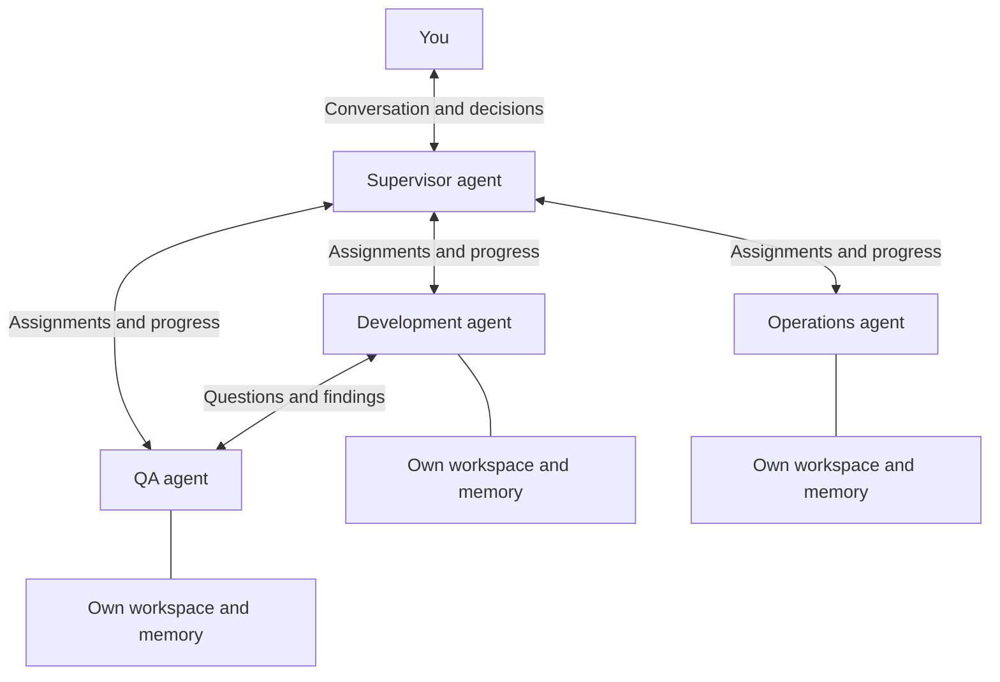
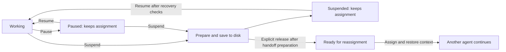

> **Under development**

# NimbleNewt

  

**Talk to your agents without making them lose their place.**

NimbleNewt gives you a persistent team of AI agents that you direct through conversation. You can ask questions, develop ideas, and change priorities while your agents keep their place in the work.

Pause and Suspend keep task working context separate from side conversations. A quick question leaves the task ready to continue; a change of task saves its working state for later. Keeping important working state separate from side conversations reduces unnecessary reconstruction and supports efficient, focused work.

The product targets **macOS, Linux, and Windows**, with configurable local and cloud models.

## Your team at a glance

You can talk to the supervisor or any agent directly. This is one example team; roles are configurable.

## How it works

- **You direct the team through conversation.** Talk to an agent or supervisor to plan a project, get help, or ask what’s happening. Your decisions take precedence over the agents’ recommendations.
- **Agents have roles and responsibilities.** Supervisors coordinate specialists in development, QA, operations, research, marketing, support, design, and documentation. They handle both individual tasks and ongoing responsibilities.
- **Each agent has its own workspace and memory.** Its “desk” holds its history, current work, and next steps. Agents can read authorized team records and ask each other questions, while keeping private scratch notes and their own environments.
- **Other tools and agents can connect.** A permission-checked API lets authorized clients add or edit durable state. Agents running in other harnesses can have ongoing, two-way conversations with NimbleNewt agents and return to the same thread later.
- **Work can be interrupted and resumed.** Agents switch between tasks and conversations while retaining the context needed to return. Pause retains assignments and allows background jobs to continue. Suspend prepares and saves work to disk so it can survive a reboot. Suspend and Release also prepares it for another agent to take over.
- **The team meets and plans.** Scheduled stand-ups let agents report progress, discuss problems, and propose improvements. You can join, call a meeting, or catch up through a summary and full transcript. Votes include short reasons; unattended decisions stay within your delegated authority.
- **Supervisors help agents get unstuck.** When an agent repeats failed steps or spends too long without useful progress, its supervisor can redirect it, interrupt a stuck model request, or try another model using saved task context. Recovery attempts have limits, and unresolved problems come back to you.
- **Models match the work.** Task difficulty selects a configurable model profile. Ordered backup models handle provider outages or planned maintenance, subject to your permissions and data-sharing settings.
- **Agents improve their tools.** They can develop skills and tools in their own environments. Authorized maintainers review useful additions for a shared toolbox. Budgets balance delivering work with improving how the team works.
- **You can review what happened.** Conversation history, tool activity, results, and recorded decisions make work inspectable. Agents check their own work, with independent QA where required.

## Talk without losing the task

Imagine an agent working on Task A when you ask, “How is it going?” It pauses the task at a safe point and answers using its task context, notes, current project files, and shared information it is allowed to read. The conversation has its own context, so incidental chat does not crowd out the task's working state.

If nothing needs to change, the agent returns to the retained Task A context and continues without starting the task over. Relevant decisions carry back into the work; the rest of the conversation stays in its own history.

If you say, “Task B is urgent. Do that first,” the agent suspends Task A: let running commands finish or end them safely, then save its progress, decisions, and next steps. After B, it restores A's saved context and checks relevant changes, such as updated files, teammate results, or new decisions, before continuing.

**Pause** sets foreground work aside while retaining the task; permitted background jobs may continue. **Suspend** prepares and saves the task for later. Both keep it assigned to the same agent. An authorized brief conversation can return to work automatically; a manual Pause or Suspend remains in place until you authorize resuming.

## Pause, come back, or hand off

Pausing keeps work assigned to the same agent. Suspension takes time to prepare and save resumable work; releasing it for another agent is an explicit choice.

Saved work survives restarts. Existing permitted background jobs may continue during Pause; Suspend settles or checkpoints them as part of preparation.

## Your projects, your rules

One human owner directs each installation. NimbleNewt works across multiple repositories and services without requiring special files in those repositories. Its internal records stay separate from the work you submit to your organization or an open-source project.

Scoped permissions, isolated agent environments, protected files, and approval rules control what agents can change. Each installation is configurable rather than tied to a particular provider or private infrastructure.

## Under the hood

A controller manages tasks, permissions, communication, model routing, and persistent records. Harness adapters run the agents, with **Pi Durable** selected as the initial runtime direction.

TypeScript is the default language for the controller, worker adapter, API, and UI, allowing direct integration with Pi Durable. A narrowly scoped Rust component is considered only when a demonstrated need justifies it.

## Design and implementation status

NimbleNewt is under development. The lifecycle and context behavior above is the product contract to implement. Pi Durable is the selected initial runtime direction; its adapter, storage and cross-platform behavior still require qualification. Efficiency and quality improvements are goals to evaluate, not measured performance claims or a launch-date commitment.

Durable continuity uses recorded histories, tool results, notes, decisions, artifacts and checkpoints. These are distinct from arbitrary process-memory snapshots, hidden model state or a provider's live KV cache. Restore native history where supported and expose fidelity limits when reconstructing from portable records. Exact bit-for-bit continuation, zero latency and universal cache retention are not promised.

Suspend must settle or explicitly track in-flight operations before declaring readiness. A blocked or uncertain effect cannot be treated as successful cleanup. Return must recheck relevant changes, ownership, permissions and lifecycle gates. Authorized peers' published work records are read-only; private scratch requires an explicit grant. See the [operational contracts](docs/nimblenewt/operational-contracts.md) and [full design](docs/nimblenewt/README.md) for these engineering boundaries.

## More detail

- [Full design and document guide](docs/nimblenewt/README.md)
- [Agent state and conversation API design](docs/nimblenewt/agent-apis.md)
- [Accepted decisions and open questions](docs/nimblenewt/design-decisions.md)
- [Harness evaluation results](docs/nimblenewt/harness-test-results.md)
- [Reproducible harness experiments](benchmarks/nimblenewt-harness/README.md)
- [Proposed implementation backlog — not yet active](docs/paperclip-backlog.md)

## License

[MIT](LICENSE). Use, modify, and share NimbleNewt, including commercially. Contributions are welcome. Third-party dependencies retain their own licenses.
